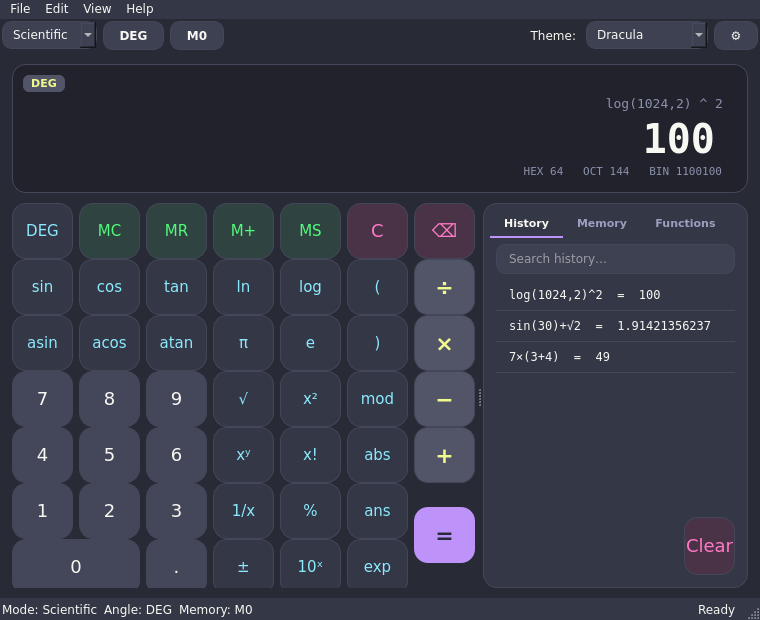
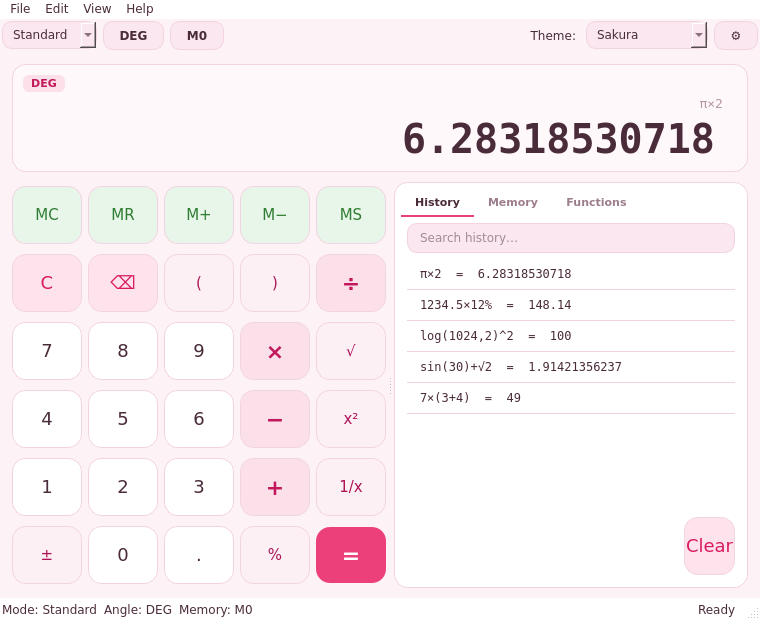

# 🧮 python-calculator

> A **themeable scientific calculator** written in Python + Qt, with a **terminal mode** that also runs on Android (Termux).

[](https://github.com/NotonPL/kalkulator-zaawansowany/actions/workflows/ci.yml)
[](LICENSE)
[](https://www.python.org/downloads/)
[](https://doc.qt.io/qtforpython/)
[](tests/)

<table>
<tr>
<td></td>
<td></td>
</tr>
<tr>
<td></td>
<td></td>
</tr>
</table>

More screenshots in [`assets/screenshots/`](assets/screenshots/) — they are rendered *from the running app* by
[`scripts/make_screenshots.py`](scripts/make_screenshots.py), so they never lie.

---

## ✨ Features

- **Two keypad modes** — Standard and Scientific (`sin/cos/tan`, `ln/log`, powers, roots, factorial, modulo, `ans`, …)
- **Safe expression engine** — a hand-written lexer + recursive-descent parser + AST evaluator (never `eval()`), with
  precise error positions, implicit multiplication (`2π`, `3(4+1)`), unicode input (`÷ × − √ ² π`), and auto-closed
  parentheses.
- **Fully themeable** — 8 built-in themes (Midnight, Light, Nord, Dracula, Solarized, Graphite, Sakura, High Contrast),
  custom accent colour, font, corner radius, spacing, key size, scale and ripple animation. Every choice is persisted
  and previewed live in the settings dialog.
- **History & memory** — searchable persistent history (JSON), ten memory registers (`MC MR M+ M− MS`).
- **Angle units** — radians / degrees / gradians, switchable on the fly.
- **Number formatting** — thousands grouping, decimal separator, precision, automatic scientific notation, plus a
  hex / oct / bin hint line.
- **i18n** — English & Polish UI, easily extendable via `i18n/*.json`.
- **Terminal (CLI) mode** — the same engine, no Qt required, perfect for servers and phones.
- **Keyboard-first** — full keyboard support, shortcuts listed under *Help → Keyboard shortcuts*.

## 🚀 Quick install

### One-liner (public fork)

```bash
curl -fsSL https://raw.githubusercontent.com/NotonPL/kalkulator-zaawansowany/main/scripts/install.sh | bash
```

### One-liner (this repo is private)

A private repo can't be fetched anonymously, so pass a token (any scope that can read the repo, e.g. a fine-grained
*read* token):

```bash
GITHUB_TOKEN=ghp_XXXX bash <(curl -fsSL https://raw.githubusercontent.com/NotonPL/kalkulator-zaawansowany/main/scripts/install.sh -H "Authorization: Bearer ghp_XXXX")
```

### Or clone with git (works always)

```bash
git clone https://github.com/NotonPL/kalkulator-zaawansowany.git
cd python-calculator
bash scripts/install.sh
```

The installer creates an isolated environment, installs the app and its optional Qt extra, and puts a `pycalc`
launcher on your `PATH`. It auto-detects phones (Termux) and installs the dependency-light CLI instead of the GUI.

## 📦 Run it

```bash
pycalc            # GUI when a display exists, terminal otherwise
pycalc cli        # force the terminal interface
python -m calc    # same thing, straight from a source checkout
pycalc --version
```

Evaluate a single expression and exit (great for scripts):

```bash
pycalc cli "2*(3+4)^2"     # = 98
```

## 🎨 Customising the look

Open **File → Settings** (or press `Ctrl+,`). Everything below is live-previewed and saved to
`~/.local/share/python-calculator/settings.json`:

| Option | What it does |
| ------ | ------------ |
| Theme | Pick any of the 8 built-in palettes |
| Accent colour | Override the theme's highlight / equals key |
| Font | Any installed font family |
| Corner radius / spacing / key size / scale | Shape the whole UI |
| Animations & ripple | Toggle the touch feedback |
| Angle unit, separators, precision | Calculation behaviour |

See [`docs/THEMING.md`](docs/THEMING.md) to author your own theme in ~20 lines.

## 🧪 Development

```bash
git clone https://github.com/NotonPL/kalkulator-zaawansowany.git
cd python-calculator
python -m venv .venv && source .venv/bin/activate
pip install -e ".[gui,dev]"
pytest            # 305 tests, headless (offscreen Qt)
```

Project layout and design decisions live in [`docs/ARCHITECTURE.md`](docs/ARCHITECTURE.md); the full function list is
documented in [`docs/EXPRESSIONS.md`](docs/EXPRESSIONS.md).

## 🤝 Contributing

Issues and pull requests are welcome — please read [`CONTRIBUTING.md`](CONTRIBUTING.md) and the
[code of conduct](CODE_OF_CONDUCT.md) first.

## 📄 License

Released under the [MIT License](LICENSE).
