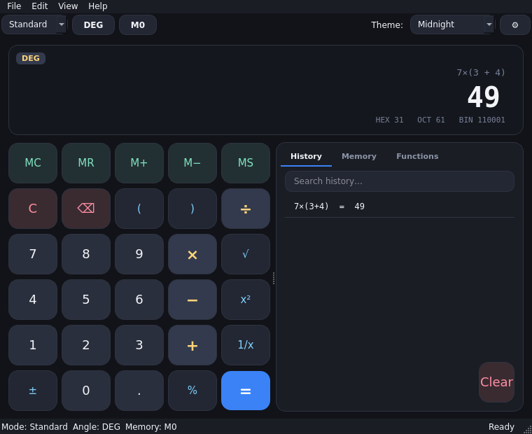
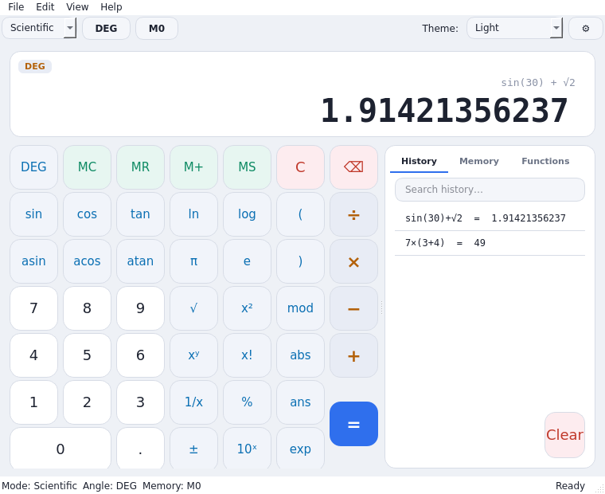

# 🧮 python-calculator

> **Motywowalny kalkulator naukowy** napisany w Pythonie + Qt, z **trybem terminalowym**, który działa też na
> Androidzie (Termux).

[](https://github.com/NotonPL/kalkulator-zaawansowany/actions/workflows/ci.yml)
[](LICENSE)
[](https://www.python.org/downloads/)

<table>
<tr>
<td></td>
<td></td>
</tr>
</table>

*Polska wersja dokumentacji. English version: [`README.md`](README.md).*

---

## ✨ Możliwości

- **Dwa tryby klawiatury** — Standardowy i Naukowy (`sin/cos/tan`, `ln/log`, potęgi, pierwiastki, silnia, modulo, `ans`).
- **Bezpieczny silnik wyrażeń** — własny lexer + parser rekurencyjny + ewaluacja AST (nigdy `eval()`), z dokładnymi
  pozycjami błędów, mnożeniem niejawnym (`2π`, `3(4+1)`), znakami unicode (`÷ × − √ ² π`) i automatycznym domykaniem
  nawiasów.
- **Pełna customizacja wyglądu** — 8 wbudowanych motywów (Midnight, Light, Nord, Dracula, Solarized, Graphite, Sakura,
  High Contrast), własny kolor akcentu, czcionka, zaokrąglenia, odstępy, rozmiar klawiszy, skala i animacja fali.
  Każda zmiana jest zapisywana i podglądana na żywo w oknie ustawień.
- **Historia i pamięć** — przeszukiwalna, trwała historia (JSON) oraz dziesięć rejestrów pamięci (`MC MR M+ M− MS`).
- **Jednostki kąta** — radiany / stopnie / grady, przełączane w locie.
- **Formatowanie liczb** — separatory tysięcy, separator dziesiętny, precyzja, notacja naukowa oraz podpowiedź
  hex / ósemk / bin.
- **i18n** — polski i angielski interfejs, łatwe rozszerzanie przez `i18n/*.json`.
- **Tryb terminalowy (CLI)** — ten sam silnik bez Qt, idealny na serwery i telefony.
- **Pełna obsługa klawiatury** — skróty pod *Pomoc → Skróty klawiszowe*.

## 🚀 Szybka instalacja

### Jedna komenda — kopia publiczna

```bash
curl -fsSL https://raw.githubusercontent.com/NotonPL/kalkulator-zaawansowany/main/scripts/install.sh | bash
```

### Jedna komenda — repo prywatne

Repozytorium prywatne nie pozwala na anonimowe pobranie, więc przekaż token (zakres tylko do odczytu repo):

```bash
bash <(curl -fsSL -H "Authorization: Bearer ghp_XXXX" \
  https://raw.githubusercontent.com/NotonPL/kalkulator-zaawansowany/main/scripts/install.sh)
```

### Albo przez git (zawsze działa)

```bash
git clone https://github.com/NotonPL/kalkulator-zaawansowany.git
cd python-calculator
bash scripts/install.sh
```

Instalator tworzy odizolowane środowisko, instaluje aplikację z opcjonalnym rozszerzeniem Qt i dodaje launcher `pycalc`
do `PATH`. Na telefonie (Termux) sam wykryje brak systemu okien i zainstaluje lekki tryb CLI zamiast GUI.

## 📦 Uruchamianie

```bash
pycalc            # GUI gdy jest wyświetlacz, inaczej terminal
pycalc cli        # wymuś terminal
python -m calc    # to samo z checkoutu źródła
pycalc --version
```

Pojedyncze wyrażenie i wyjście (przydatne w skryptach):

```bash
pycalc cli "2*(3+4)^2"     # = 98
```

## 🎨 Customizacja wyglądu

Otwórz **Plik → Ustawienia** (lub `Ctrl+,`). Wszystko jest podglądane na żywo i zapisywane w
`~/.local/share/python-calculator/settings.json`:

| Opcja | Działanie |
| ----- | --------- |
| Motyw | wybór spośród 8 wbudowanych palet |
| Kolor akcentu | nadpisuje wyróżnienie / klawisz "=" |
| Czcionka | dowolna zainstalowana rodzina |
| Zaokrąglenia / odstępy / rozmiar klawiszy / skala | kształt całego UI |
| Animacje i fala | włącz/wyłącz reakcję na dotyk |
| Kąt, separatory, precyzja | zachowanie obliczeń |

Jak dodać własny motyw w ~20 liniach — patrz [`docs/THEMING.md`](docs/THEMING.md).

## 🧪 Rozwój

```bash
git clone https://github.com/NotonPL/kalkulator-zaawansowany.git
cd python-calculator
python -m venv .venv && source .venv/bin/activate
pip install -e ".[gui,dev]"
pytest            # 305 testów, bez wyświetlacza (offscreen Qt)
```

## 📄 Licencja

[MIT](LICENSE).
